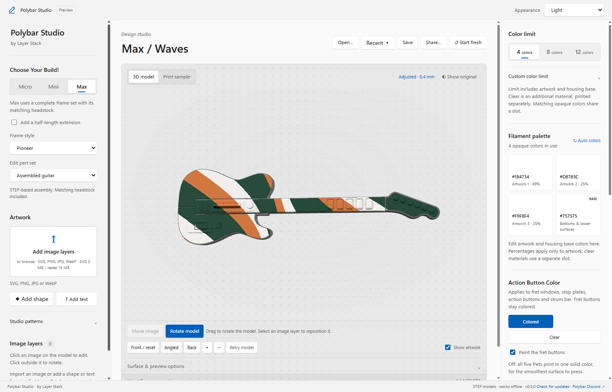
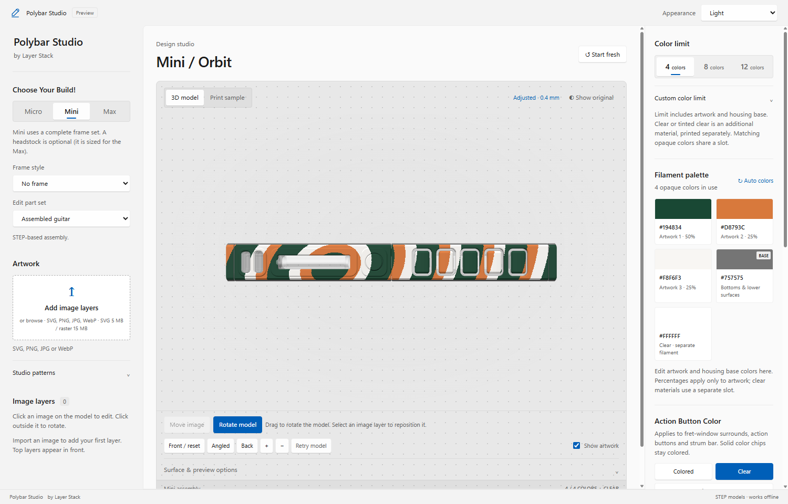
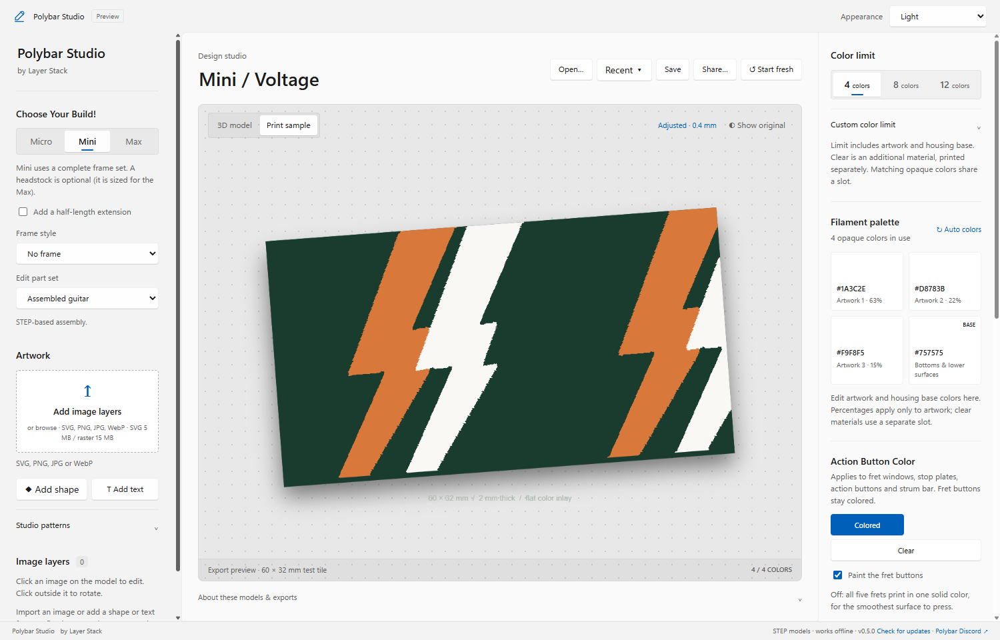
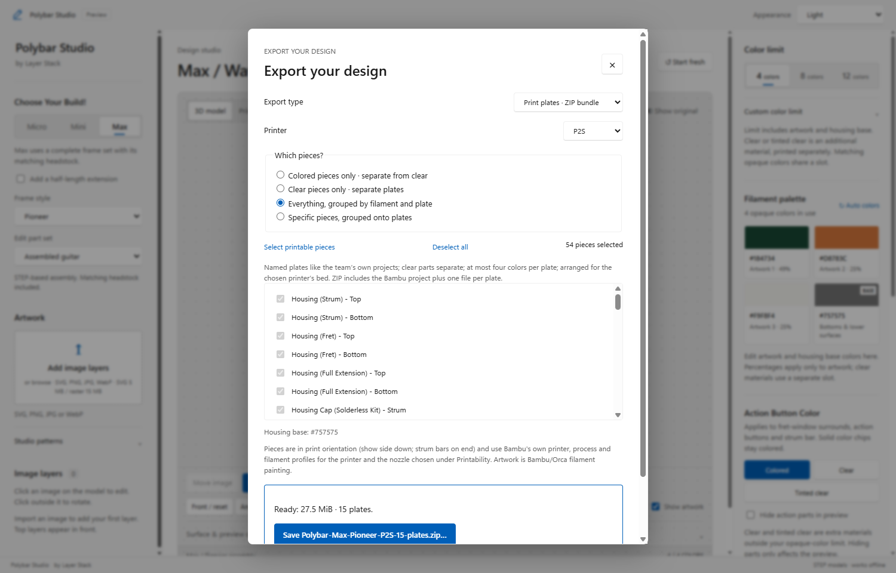
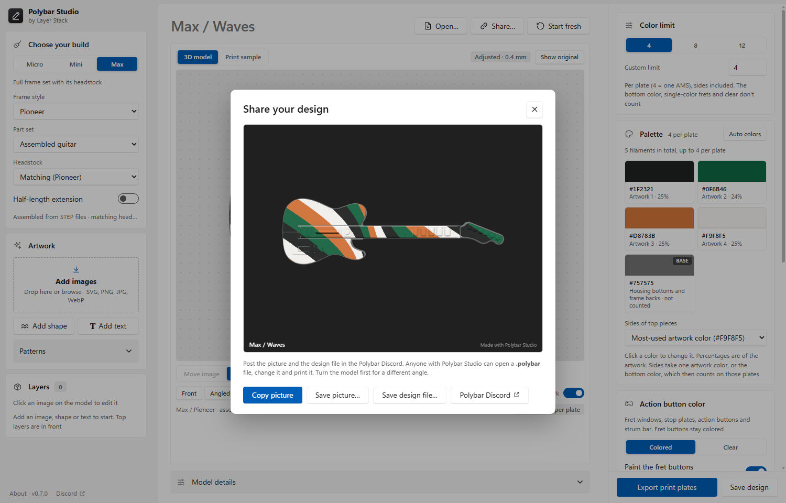

# Polybar Studio

Paint your Polybar Micro, Mini or Max, then get a print-ready Bambu Studio project for your Bambu Lab printer.

Windows 10 or 11, 64-bit · about 50 MB · works offline · [all releases](https://github.com/3D-Printed-Controller-Systems/Polybar-Studio-Release/releases) · share your designs in the [Polybar Discord](https://discord.gg/wBRdgxEGhe)

<picture>
  <source media="(prefers-color-scheme: dark)" srcset=".github/assets/app-dark.png">
  
</picture>

## Install

1. Click **Download for Windows** above and run `Polybar-Studio-Windows.exe`.
2. Windows may say **"Windows protected your PC"**, because the installer isn't code-signed yet. Click **More info**, then **Run anyway**.
3. The installer needs no administrator rights. Afterwards, open **Polybar Studio** from the Start menu.

Windows 11 already has everything the app needs. On Windows 10 the installer may download Microsoft's WebView2 runtime first, so be online the first time.

## How to use it

The window has three columns: your **build and artwork** on the left, the **3D preview** in the middle, and **colors and export** on the right. Work from top to bottom.

### 1. Choose your build

Under **Choose your build**, pick **Micro**, **Mini** or **Max**.

- **Micro** has no frame.
- **Half-length extension** (a switch) makes any Mini or Max longer by 85 mm (on a Max it goes after the full extension). It works with every frame.
- **Mini** and **Max** have a **Frame style** list (Airbourne, Diablo, Maverick, Nomad, Offset, Pioneer, Renegade, Vampire, Wizard; Max also has the older Enforcer). Choose **No frame** for the bare controller.
- **Headstock:** a Max frame comes with its matching headstock. Any Mini or Max can take any family's headstock from the **Headstock** list (on a Mini it's off by default: it's sized for the Max).
- **Part set** switches the preview between the assembled guitar, the frame only, and the headstock. Your artwork stays in the same place in every view. In **Frame only**, the housing is drawn see-through blue: artwork stops where it covers the frame, because that part is hidden on the finished guitar.

Drag in the preview to rotate, scroll to zoom, right-drag to pan. **Front**, **Angled** and **Back** jump to a view.

### 2. Add your artwork

- Drop images onto **Add images**, or click it to browse. New images, shapes and text start on the largest open area of the body. SVG (up to 5 MB), PNG, JPG and WebP (up to 15 MB) work; you can stack up to 12 layers.
- Click an image on the model to select it, then drag it into place. Clicking anywhere inside a selected image's box keeps it selected. **Size** and **Rotation** have sliders and number boxes you can type in; **Center**, **Fit** and **Done** are below them. Click away from the image to go back to rotating the model.
- **Keyboard** (while an image is selected): arrows move it; **Ctrl + ↑ / ↓** or **+ / −** resize; **Ctrl + ← / →** or **[ ]** rotate; hold **Shift** for bigger steps; **Ctrl + D** duplicates; **Delete** removes; **Esc** deselects.
- Each layer in **Layers** shows a small preview. **⧉** duplicates a layer, the trash can removes it.
- **Repeat** (under the selected image) tiles it as a pattern: set the spacing, and optionally offset every other row. Dragging any copy moves them all.
- **Add shape** adds a circle, ring, square, triangle, diamond, hexagon, star, burst, heart, lightning bolt, arrow or music note. **Add text** adds text: type it under the selected layer and pick a font and Bold. Shapes and text are one color: recolor them with their color dot.
- **Background › Remove** takes out a solid background around a logo. Raise **Tolerance** if some background stays.
- A one-color image (a typical logo) gets a small **color dot** in its row under **Layers**: click it to recolor the whole image.
- **Name your design:** click the title above the preview (for example "Mini / Plain") and type. The name is used for the export files.
- No image? Open **Patterns** for Waves, Checkers, Voltage or Orbit. **Keep pattern behind images** puts a pattern under your images.

### 3. Pick your colors

- **Color limit** is how many colors each print plate may use: 4 (one AMS), 8, 12, or a custom number. The artwork is reduced to fit. The bottom color, single-color frets and clear don't count: they're extra filaments on their own plates.
- **Palette** shows each color and how much of the artwork uses it. Click a swatch to pick from Bambu Lab's own **PLA Basic** and **PLA Matte** spool colors, or choose **Custom color…**. **Auto colors** rebuilds the palette from the artwork.
- **BASE** is the housing's bottom and lower surfaces (gray by default).

### 4. Action button color

Choose how the fret windows, stop plates, action buttons and strum bar are printed:

- **Colored:** painted with the artwork like everything else.
- **Clear:** they print in clear PETG (PETG Translucent). This is an extra material on top of your color limit.

**Paint the fret buttons** (on by default) paints the five frets with the artwork. Turn it off for frets in one solid color you pick (a smoother surface to press); that color is an extra filament and doesn't count toward the limit.

<picture>
  <source media="(prefers-color-scheme: dark)" srcset=".github/assets/clear-dark.png">
  
</picture>

**Hide action parts in preview** only changes what you see, not the export.

### LED light

Light colors on the fret and strum housings let the LEDs shine through. Turn on **Block LED light** (right side, under Action button color) and those two housings keep their first 3 mm (the show side) in your colors and print everything above it in your palette's darkest color. That color is already one of your filaments, so it needs no extra AMS slot. The sides of those housings show that color above 3 mm.

It's off by default. When you export with light colors on those housings and a dark color in your palette, Polybar Studio asks whether to turn it on. If your palette has no dark color (all pastels, say), there's nothing to block with and the switch stays off.

### 5. Check printability

- Set **Nozzle size** to the nozzle you print with (0.4 mm is standard).
- Leave **Optimize for printing** on: it makes sure every color is at least a printable width everywhere, thickening thin lines and clearing hairline gaps and specks. **Adjustment strength** sets that width: Gentle 1.5×, Balanced 2× and Strong 2.5× the nozzle (0.6 / 0.8 / 1.0 mm on a 0.4 mm nozzle). The status line says "Every color … mm+ wide ✓", or how much is still thinner.
- Exporting with optimization off, or with anything still too thin, shows **Print at your own risk**: tick "I understand…" to continue.
- **Show original** compares before and after. **Print sample** (above the preview) shows the artwork flat, as printed.

<picture>
  <source media="(prefers-color-scheme: dark)" srcset=".github/assets/sample-dark.png">
  
</picture>

### 6. Export

Click **Export print plates**.

- **Export type:** *Print plates · ZIP bundle* (the whole guitar) or a *60 × 32 mm color test tile* (a quick way to check your colors first).
- **Printer:** every Bambu Lab printer (A1, A1 mini, A2L, H2C, H2D, H2D Pro, H2S, P1P, P1S, P2S, X1, X1 Carbon, X1E, X2D). The project uses Bambu's own profiles for that printer and the nozzle chosen under Printability. If a piece is too big for the printer (a Micro housing on an A1 mini), the export says so.
- **Which pieces?** Everything, only the colored pieces, only the clear pieces, or pieces you tick yourself.
- **Include the assembly parts** (on by default) adds the color plates, power slider and pivot pins (and on a Micro the PCB braces) in the housing base color.
- Click **Prepare export**, wait for **Ready**, then **Save…** and choose where to put it.

<picture>
  <source media="(prefers-color-scheme: dark)" srcset=".github/assets/export-dark.png">
  
</picture>

**More exports** (above the export button) has **Artwork PNG**, which saves the flat artwork as an image, and **Clear parts plate**.

### 7. Print it

Unzip the bundle. It contains:

- `Polybar-<printer>.3mf` (for example `Polybar-P2S.3mf`): open this in **Bambu Studio**. It's a complete project: plates are named (Housing Shells - Top, Transparent Input Parts, Assembly Parts, one plate per frame wing and faceplate…) and arranged, matching parts are grouped (the five windows are one object), every piece is turned the way it prints (show side down on the textured plate), clear pieces are on their own plates, and each plate uses at most four colors with its prime-tower corner kept free. Press **A** (Arrange) if you want Bambu to re-arrange a plate.
- `Individual-plates/`: one file per plate, for OrcaSlicer, PrusaSlicer or printing one plate at a time.
- `Plate-manifest.json` and `README.txt`: what's on each plate.

In the slicer, pick your actual filament profiles, check that each color goes to the right AMS slot, and look over the sliced preview before printing.

## Save, open and share designs

- **Save** (Ctrl + S) saves your design as a `.polybar` file: the build, colors, print settings and every layer. **Ctrl + Shift + S** saves a copy under a new name. **Open…** (Ctrl + O) opens one; **Recent** lists the designs you used lately. Double-clicking a `.polybar` file in Explorer opens it too.
- Polybar Studio also keeps your work every 30 seconds. If it closes unexpectedly, choose **Restore it** the next time it opens.
- **Share…** makes a picture of your design (turn the model first for a different angle). **Copy picture** and paste it into your post, and **Save design file…** to attach the `.polybar` file so others can open, change and print it. **Polybar Discord ↗** takes you to the community ([discord.gg/wBRdgxEGhe](https://discord.gg/wBRdgxEGhe)); the same link is at the bottom left of the window.

<picture>
  <source media="(prefers-color-scheme: dark)" srcset=".github/assets/share-dark.png">
  
</picture>

## Good to know

- **Updates:** Polybar Studio checks when it starts, every 4 hours and when you come back to it. When a new version is out, a bar at the top offers **Update** or **Later** (your design is kept). **About** shows when it last checked. Turn on **Install updates automatically on start** to skip the question, or open **About** (bottom left) and click **Check now**. Updates are signed, so the app only installs genuine ones.
- **Enforcer** can be previewed and painted, but can't be exported as print plates yet.
- Exports have been sliced with Bambu Studio's command line (all plates, painted colors intact). Please report anything that looks wrong when you open one (a wrong color, a piece upside down, an odd layout).

## Releases

Each release lists the installer's SHA-256 and the [Development](https://github.com/3D-Printed-Controller-Systems/Polybar-Studio-Development) commit it was built from.

**0.7.2**: the printer and export type can be changed again in the Export dialog; artwork stays put when you switch between Assembled guitar, Frame only and the headstock; the housing shows see-through in Frame only; new shapes, text and images start on the body; update checks while the app is open, with an update bar.

**0.7.1**: Block LED light (the darkest palette color behind the fret and strum housings, so light colors don't glow); Polybar Studio asks on export when it would help.

**0.7.0**: a new look that matches the 3DPCS Controller Tool (switches, button groups, Windows drop-down lists, an About sheet with Light / Dark / Windows appearance); smooth artwork edges, with no jagged fringe along curves in the preview or the export; Start fresh asks first; shorter text throughout.

**0.6.0**: sharp artwork at print resolution (shapes, text and SVGs from their outlines, exact colors, no edge shadow); the color limit is per plate, and the bottom color, solid frets and clear don't count; any headstock on any Mini or Max; resize and rotate handles; joystick painted on top only; 33 new fonts; Export and Save design always visible; a first-export checklist.

**0.5.0**: save and open designs (`.polybar` files, Recent, autosave and Restore, double-click to open); Share (a picture and the design file) and the Polybar Discord link; shapes and text; updates from inside the app.

**0.4.0**: printable-width guarantee with a "print at your own risk" warning; single-color frets; Bambu spool color presets; typed values, keyboard shortcuts, layer previews, duplicate and repeat for images; rename your design; the color plates, power slider and pivot pins in the export; "Tinted clear" removed.

**0.3.2**: exports for dual-nozzle printers (H2D, H2D Pro, H2C, X2D) now slice (0.3.1's failed); half-length extension for any Mini or Max.

**0.3.1**: exports open and slice in Bambu Studio (0.3.0's crashed it); choose any Bambu Lab printer; named, arranged plates like the team's own projects; clear stop plates; color dot to recolor one-color images; optional Max headstock on a Mini; the 3D model now follows palette color changes.

**0.3.0** (first Windows release): the desktop app, rebuilt from the earlier browser preview. Installer about 50 MB.
