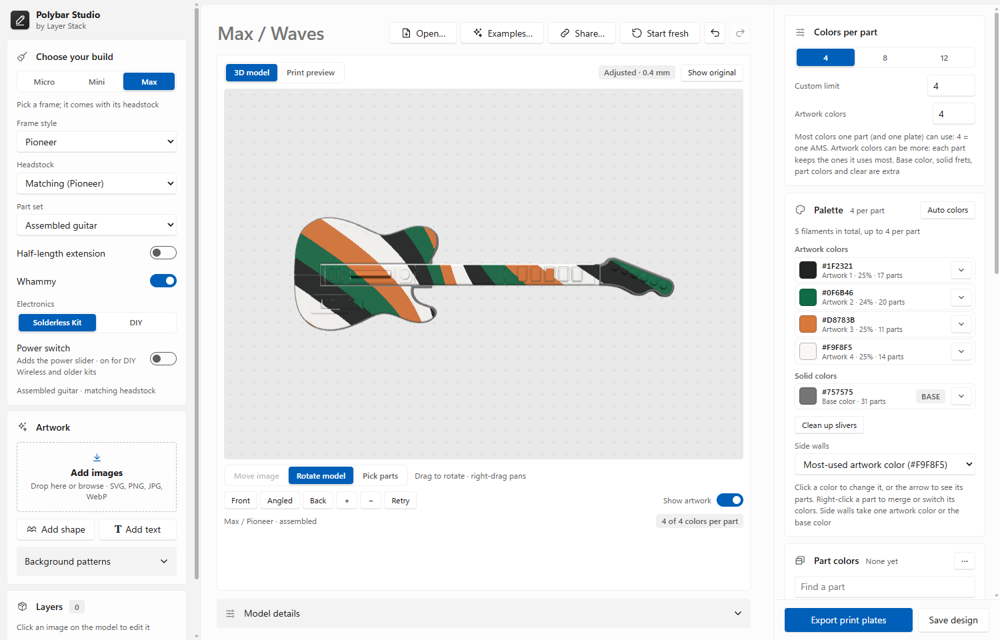
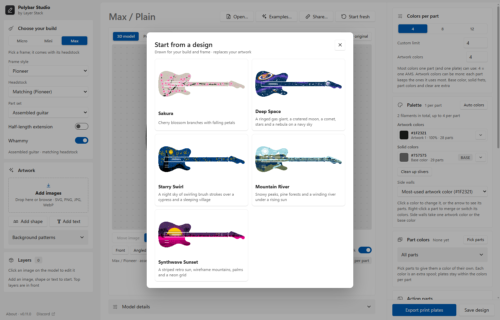
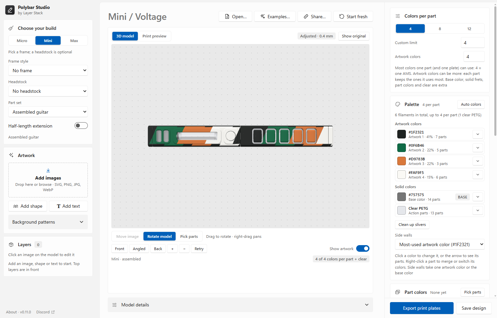
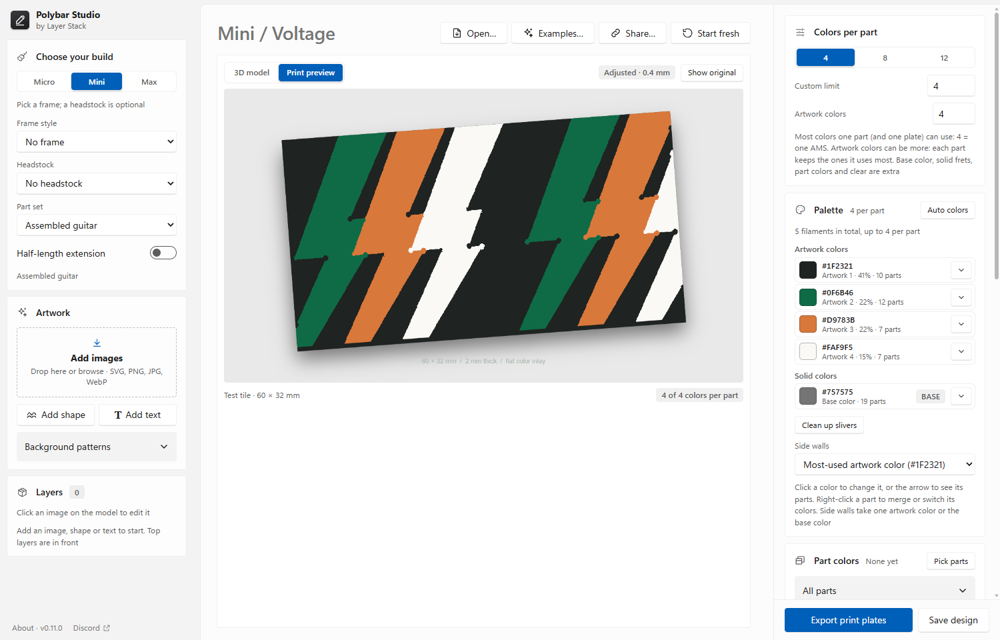
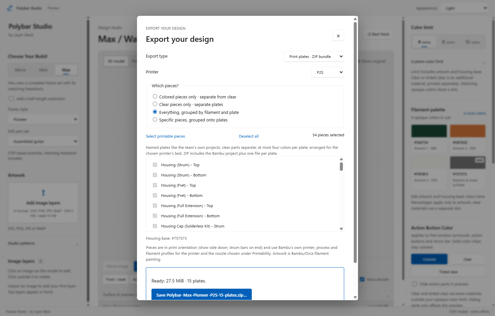
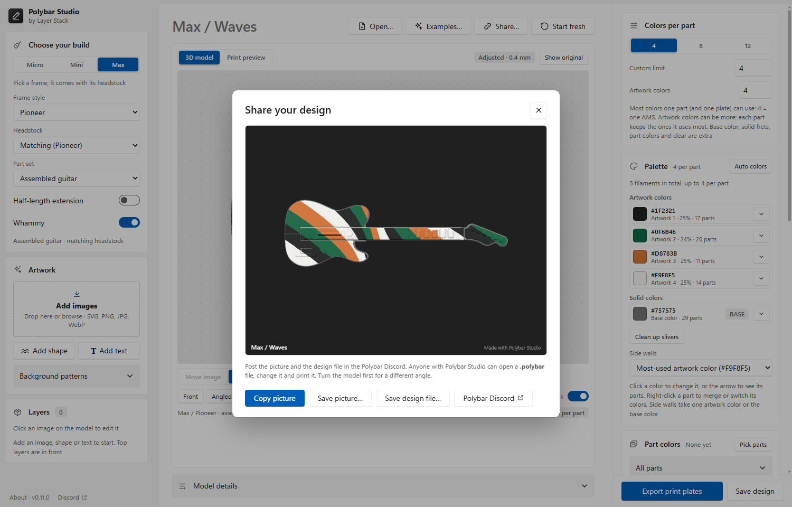

# Polybar Studio

Paint your Polybar Micro, Mini or Max, then get a print-ready Bambu Studio project for your Bambu Lab printer.

Windows 10 or 11, 64-bit · about 50 MB · works offline · [all releases](https://github.com/3D-Printed-Controller-Systems/Polybar-Studio-Release/releases) · share your designs in the [Polybar Discord](https://discord.gg/wBRdgxEGhe)

<picture>
  <source media="(prefers-color-scheme: dark)" srcset=".github/assets/app-dark.png">
  
</picture>

## Install

1. Click **Download for Windows** above and run `Polybar-Studio-Windows.exe`.
2. Windows may say **"Windows protected your PC"**, because the installer isn't code-signed yet. Click **More info**, then **Run anyway**.
3. The installer needs no administrator rights. Afterwards, open **Polybar Studio** from the Start menu.

Windows 11 already has everything the app needs. On Windows 10 the installer may download Microsoft's WebView2 runtime first, so be online the first time.

## How to use it

The window has three columns: your **build and artwork** on the left, the **3D preview** in the middle, and **colors and export** on the right. Work from top to bottom.

### 1. Choose your build

Under **Choose your build**, pick **Micro**, **Mini** or **Max**.

- **Micro** has no frame.
- **Half-length extension** (a switch) makes any Mini or Max longer by 85 mm (on a Max it goes after the full extension). It works with every frame.
- **Mini** and **Max** have a **Frame style** list (Airbourne, Diablo, Maverick, Nomad, Offset, Pioneer, Renegade, Vampire, Wizard). Choose **No frame** for the bare controller.
- **Headstock:** a Max frame comes with its matching headstock. Any Mini or Max can take any family's headstock from the **Headstock** list (on a Mini it's off by default: it's sized for the Max).
- **Whammy** (a switch, on a Max with a frame): turn it off if you don't want a whammy. The whammy chassis, bar, magnet paddle and its two pivot pins then leave the preview and the export. A plug to close the opening is coming; until then the opening stays empty.
- **Electronics:** **Solderless Kit** (the default) or **DIY**. DIY prints the DIY strum end cap (its USB opening differs) and turns the Power switch on; Solderless Kit prints its own cap and turns the Power switch off.
- **Power switch** (a switch): off, every color plate opening gets a blank plate (the new Solderless Kit boards have the power circuit built in). On, the strum housing gets the power slider (its color plate, toggle plate and switch) instead of a blank. Picking the electronics sets it (on for DIY, since DIY Wireless needs it), but you can always change it: turn it on for older Solderless Kit electronics, or off for a wired DIY build.
- **Part set** (under Headstock) switches the preview between the assembled guitar, the frame only, and the headstock. Your artwork stays in the same place in every view. **Frame only** shows just the frame; artwork stops where the housing covers it on the finished guitar.

Drag in the preview to rotate, scroll to zoom (it zooms toward the mouse pointer), right-drag to pan. Right-drag pans even while an image is selected, so you can zoom in on a horn or the headstock and move around while you place artwork. **Front**, **Angled** and **Back** jump to a view.

### 2. Add your artwork

- **Start from an example:** click **Examples…** (above the preview) for Sakura, Deep Space, Starry Swirl, Mountain River or Synthwave Sunset. Each one is drawn for the build and frame you chose (Mini or Max), with its main pieces on the body and headstock, in four Bambu spool colors. It replaces your artwork; everything else stays. Change any of its four layers or colors afterwards.
  - **It follows your build:** change the size, frame, headstock or half-length extension and the example is drawn again for the new shape by itself. Colors you changed on its layers stay. A saved design remembers its example, so it keeps doing this when you open it again.
  - **Detail:** the examples are drawn with fine detail (lines down to 0.8 mm), so they print best with a 0.4 mm nozzle. On a 0.6 mm nozzle the app thickens the finest lines, as it does for any artwork.

<picture>
  <source media="(prefers-color-scheme: dark)" srcset=".github/assets/examples-dark.png">
  
</picture>

- Drop images onto **Add images**, or click it to browse. New images, shapes and text start on the largest open area of the body. SVG (up to 5 MB), PNG, JPG and WebP (up to 15 MB) work; you can stack up to 12 layers.
- Click an image on the model to select it, then drag it into place. Clicking anywhere inside a selected image's box keeps it selected. **Size** and **Rotation** have sliders and number boxes you can type in; **Center**, **Fit** and **Done** are below them. Click away from the image to go back to rotating the model.
- **Keyboard** (while an image is selected): arrows move it; **Ctrl + ↑ / ↓** or **+ / −** resize; **Ctrl + ← / →** or **[ ]** rotate; hold **Shift** for bigger steps; **Ctrl + D** duplicates; **Delete** removes; **Esc** deselects.
- Each layer in **Layers** shows a small preview. **⧉** duplicates a layer, the trash can removes it.
- **Repeat** (under the selected image) tiles it as a pattern: set the spacing, and optionally offset every other row. Dragging any copy moves them all.
- **Add shape** adds a circle, ring, square, triangle, diamond, hexagon, star, burst, heart, lightning bolt, arrow or music note. **Add text** adds text: type it under the selected layer and pick a font and Bold. Shapes and text are one color: recolor them with their color dot.
- **Background › Remove** takes out a solid background around a logo. Raise **Tolerance** if some background stays.
- A one-color image (a typical logo) gets a small **color dot** in its row under **Layers**: click it to recolor the whole image.
- **Name your design:** click the title above the preview (for example "Mini / Plain") and type. The name is used for the export files.
- No image? Open **Background patterns** for Waves, Checkers, Voltage or Orbit. **Keep pattern behind images** puts a pattern under your images.

### 3. Pick your colors

**How many colors.** Two numbers at the top of the right column decide this:

- **Colors per part** is the most colors one printed part may use: 4 (one AMS), 8, 12, or a custom number. Every print plate stays within it too, and the export adds plates when it needs to. The base color, single-color frets, parts in a color of their own and clear are extra filaments on top.
- **Artwork colors** is how many colors your artwork keeps in total, up to 16. Leave it equal to Colors per part and every part can show every color. Set it higher (say 8 artwork colors at 4 per part) and the artwork keeps all 8, while each part keeps only the 4 covering most of it, and any other color on that part prints in its nearest kept color. A note under the palette says how many parts this trims, and the 3D view shows exactly what will print.

**The palette** is a list with one row per filament, in two groups: **Artwork colors** and **Solid colors** (the base color, single-color frets, parts in a color of their own, and clear).

- Each row shows the color, how much of the artwork uses it, and how many parts print it.
- Click the color square to pick from Bambu Lab's own **PLA Basic** and **PLA Matte** spool colors, or choose **Custom color…**.
- **Auto colors** rebuilds the palette from the artwork. It only uses real colors from your artwork, not the blended shades along soft edges.
- **BASE** (the base color) is the housing's bottom and lower surfaces (gray by default). **Side walls** picks the color of the painted pieces' sides: one artwork color or the base color. A part always keeps its side color.
- **Color the edges** (a switch under Side walls): every chamfer, rim and rounded edge of the painted pieces prints in the **Edge color** (white by default; click it for any spool color), straight from the controller's shape. With dark artwork you get crisp edge accents everywhere (the fret windows, tuners, housing joints and body outline), with nothing to draw. **Steeper than** sets how steep a face must be (30° by default; lower takes in gentler slopes). Textured surfaces like the whammy grip keep the artwork color. The edge color is one more filament: each piece keeps one color free for it, so it needs at least 3 colors per part. Set **Side walls** to **Edge color** to give the walls the same color at no extra cost.

**Which parts print a color.** Click the **arrow** at the end of a row to open the parts that print that color, largest share first.

- Each part shows a small dot for **every** color it prints, with this row's color ringed, so multi-color parts are easy to spot. The number is how much of that part this color covers.
- **→ ●** means this color doesn't print on that part: it prints as the color after the arrow (the color limit trimmed it, or you merged or switched it).
- A faded part shows the color only as a sliver (under 1%) or not at all after a change.

**Change a color on one part.** Right-click a part in that list (or click its **⋯** button), or right-click the part right on the 3D model for the color under the mouse pointer:

- **Merge … into**: print this color as another color the part already prints. The part uses one color less.
- **Switch … to**: print it as any other artwork color, even one the part doesn't have yet.
- **Keep … on this part**: shown when the color limit trimmed the color; the part keeps it and drops its next least-used color instead.
- **Give it its own color…**: the whole part in one solid color (see Part colors below). **Use the design's colors** undoes that.
- **Show in 3D**: picks the part on the model.
- **Reset to automatic**: forgets the merges, switches and keeps on that part.

A part never goes over Colors per part: if your changes would push it over, it still keeps its most-used colors. Your changes are saved with the design, and they stay when you edit the palette or press Auto colors, as long as those colors are still in it.

**Clean up slivers** (under the palette): on every part, colors covering less than 1% of it (a thin soft edge, a stripe that just touches it) merge into the nearest color the part shows more of. Changes you already made stay.

### Part colors

Any part can have a solid color of its own, so you can print every part in a different color if you like.

1. Click **Pick parts** (under the preview). The part under the mouse pointer lights up.
2. Click a part on the model to pick it (it turns blue); **Ctrl**-click picks more, or unpicks one. Clicking empty space clears the pick.
3. In the bar at the top of the Part colors card, click **Color…** to choose its color, or **×** to give it back the design's colors.
4. Click **Rotate model** or press **Esc** to stop picking.

The Part colors card lists the parts you've given a color of their own, each with a swatch on the right (click it to change that color). **Find a part** searches every part. **All parts** lists them all in folded groups by where they go: Strum case, Fret case, Extensions, Housing, Frame, Headstock, and Assembly parts. Identical parts are one row ("Fret - Window ×5"): click it to pick all of them, or open it with the arrow for each one. A part's dot shows what it prints (hover for the name: Artwork, Base color, Fret color, Own color or Clear). Click a row to pick it, right-click it for its menu. Picking a part on the model opens the list at that part. **⋯ › Reset all parts** gives every part the design's colors again.

**Every part of the finished controller is in the model**, so you can see and color them: the color plates in the bottom housings, the pivot pins (two for the strum bar, two more for a whammy), the whammy's magnet paddle, the frame's two strap lugs, the Micro's PCB braces, the Vampire headstock's four tuner tabs, and with the Power switch on the power slider. Most sit underneath or inside: use the **Back** view, or find them in All parts. They print in the base color unless you give them a color.

Each color of its own is one more filament. It never counts toward Colors per part; the export puts parts on as many plates as it needs.

### 4. Action parts

**Clear action parts** (a switch) prints the fret windows, stop plates, action buttons and strum bar in clear PETG (PETG Translucent) instead of painting them with the artwork. Clear is an extra material on top of your colors per plate.

**Paint the fret buttons** (on by default) paints the five frets with the artwork. Turn it off for all five in one solid color: it starts in the color your artwork shows on the frets, and you can pick another. A color that isn't in your artwork is an extra filament and doesn't count toward the limit. The five fret color chips always print in one solid color each (the artwork color covering most of the chip), so they look the same from every side.

<picture>
  <source media="(prefers-color-scheme: dark)" srcset=".github/assets/clear-dark.png">
  
</picture>

**Hide action parts in preview** only changes what you see, not the export.

### LED light

Light colors on the fret and strum housings let the LEDs shine through. Turn on **Block LED light** (right side, under Action parts) and the last part of those housings' 4 mm shell, plus the walls above it, print in your palette's darkest color; the show side in front of it stays in your colors. That color is already one of your filaments, so it needs no extra AMS slot.

- **Dark layer** (slider or type a value) sets how thick that dark part is: 1.6 mm by default, in whole layers for your nozzle ("1.6 mm · 8 layers" on a 0.4 mm nozzle). At least 1 mm of your colors always stays in front.
- A warning line appears under it when the layer may be **too thin to block all LED light** (under about 0.6 mm for black, about 1.2 mm for other dark colors like dark blue or brown), or when so little of your colors is left that they **may look darker** (under about 1.4 mm). These are starting estimates, not measurements yet. The Export dialog repeats them.
- To see for yourself, add the **LED test tile** to your export (Advanced in the Export dialog): a strip of your lightest color over your darkest at five dark thicknesses (0.4 to 2.0 mm), each labeled on the back. Print it and hold it over a lit fret LED.

It's off by default. When you export with light colors on those housings and a dark color in your palette, Polybar Studio asks whether to turn it on. If your palette has no dark color (all pastels, say), there's nothing to block with and the switch stays off.

### 5. Check printability

- Set **Nozzle size** to the nozzle you print with (0.4 mm is standard).
- Leave **Fix thin lines** on: it makes sure every color is at least a printable width everywhere, thickening thin lines and clearing hairline gaps and specks (in the print only; your images aren't changed). **Strength** sets that width: Gentle 1.5×, Balanced 2× and Strong 2.5× the nozzle (0.6 / 0.8 / 1.0 mm on a 0.4 mm nozzle). The status line says "Every color … mm+ wide ✓", or how much is still thinner.
- Exporting with Fix thin lines off, or with anything still too thin, shows **Print at your own risk**: tick "I understand…" to continue.
- **Show original** compares before and after. **Print preview** (above the 3D view) shows the artwork flat, as printed.

<picture>
  <source media="(prefers-color-scheme: dark)" srcset=".github/assets/sample-dark.png">
  
</picture>

### 6. Export

Click **Export print plates**.

- **Printer:** every Bambu Lab printer (A1, A1 mini, A2L, H2C, H2D, H2D Pro, H2S, P1P, P1S, P2S, X1, X1 Carbon, X1E, X2D). The project uses Bambu's own profiles for that printer and the nozzle chosen under Printability. If a piece is too big for the printer (a Micro housing on an A1 mini), the export says so.
- The dialog shows what you'll get (plates for your printer and nozzle, up to your colors per part on each plate) and the filaments to load.
- **Advanced** (folded by default):
  - **Which pieces?** Everything, only the colored pieces, only the clear pieces, or pieces you pick from the list, grouped by Strum case, Fret case, Extensions, Frame and Headstock.
  - **Assembly parts** (on by default): the color plates, pivot pins and strap lugs (and the power slider with the Power switch on, and on a Micro the PCB braces), in the base color unless given a color.
  - **Color test tile** and **LED test tile** (off by default): add a 60 × 32 mm tile of your colors, or the LED test tile (see LED light above), to the bundle's `Test-tiles` folder.
- Click **Prepare export**. A progress bar shows about how long is left; when it says **Ready**, click **Save…** and choose where to put it.

<picture>
  <source media="(prefers-color-scheme: dark)" srcset=".github/assets/export-dark.png">
  
</picture>

**More exports** (above the export button) has **Save artwork PNG**, which saves the flat artwork as an image, and **Export clear parts**.

### 7. Print it

Unzip the bundle. It contains:

- `Polybar-<printer>.3mf` (for example `Polybar-P2S.3mf`): open this in **Bambu Studio**. It's a complete project: plates are named (Housing Shells - Top, Transparent Input Parts, Input & Assembly Parts, one plate per frame wing and faceplate…) and arranged, matching parts are grouped (the five windows are one object), every piece is turned the way it prints (show side down on the textured plate), and each plate uses at most four colors with its prime-tower corner kept free. With clear action parts, the fret inserts print on the clear parts' plate. With painted action parts, the fret windows get a plate of their own (tall, thin parts print better without others wobbling around them), and the stop plates, fret inserts, pivot pins and headstock dowel share a **Small Parts** plate. The strum bar prints with slim tree supports; nothing else needs supports. Press **A** (Arrange) if you want Bambu to re-arrange a plate.
- `Individual-plates/`: one file per plate, for OrcaSlicer, PrusaSlicer or printing one plate at a time.
- `Plate-manifest.json` and `README.txt`: what's on each plate.

In the slicer, pick your actual filament profiles, check that each color goes to the right AMS slot, and look over the sliced preview before printing.

## Undo and redo

**Ctrl + Z** undoes your last change and **Ctrl + Y** (or **Ctrl + Shift + Z**) redoes it; the undo and redo arrows next to **Start fresh** do the same. Up to 50 steps.

- It covers layers (adding, moving, resizing, recoloring, deleting), colors, part colors and per-part merges, switches and keeps, the build, action parts, and print settings.
- A drag or a slider counts as one step. **Start fresh**, **Open…** and **Examples…** can be undone too, so an accidental Start fresh is one Ctrl + Z away.
- Turning the model and switching **Part set** aren't steps. While you type in a text box, Ctrl + Z undoes your typing there.

## Save, open and share designs

- **Save** (Ctrl + S) saves your design as a `.polybar` file: the build, colors, print settings and every layer. **Ctrl + Shift + S** saves a copy under a new name. **Open…** (Ctrl + O) opens one; **Recent** lists the designs you used lately. Double-clicking a `.polybar` file in Explorer opens it too.
- Polybar Studio also keeps your work every 30 seconds. If it closes unexpectedly, choose **Restore it** the next time it opens.
- **Share…** makes a picture of your design (turn the model first for a different angle). **Copy picture** and paste it into your post, and **Save design file…** to attach the `.polybar` file so others can open, change and print it. **Polybar Discord ↗** takes you to the community ([discord.gg/wBRdgxEGhe](https://discord.gg/wBRdgxEGhe)); the same link is at the bottom left of the window.

<picture>
  <source media="(prefers-color-scheme: dark)" srcset=".github/assets/share-dark.png">
  
</picture>

## Keyboard shortcuts

| Keys | What it does |
| --- | --- |
| **Ctrl + Z** / **Ctrl + Y** (or Ctrl + Shift + Z) | Undo / redo |
| **Ctrl + S** / **Ctrl + Shift + S** / **Ctrl + O** | Save / save a copy / open |
| Arrows | Move the selected image (hold **Shift** for bigger steps) |
| **Ctrl + ↑ / ↓** or **+ / −** | Resize the selected image |
| **Ctrl + ← / →** or **[ ]** | Rotate the selected image |
| **Ctrl + D** / **Delete** | Duplicate / remove the selected image |
| **Esc** | Deselect the image, close a menu, or stop picking parts |
| Right-click a part | Its color menu (on the model, in All parts, or in the palette) |

## Good to know

- **Updates:** Polybar Studio checks when it starts, every 4 hours and when you come back to it. When a new version is out, a bar at the top offers **Update** or **Later** (your design is kept). **About** shows when it last checked. Turn on **Install updates automatically on start** to skip the question, or open **About** (bottom left) and click **Check now**. Updates are signed, so the app only installs genuine ones.
- Exports have been sliced with Bambu Studio's command line (all plates, painted colors intact). Please report anything that looks wrong when you open one (a wrong color, a piece upside down, an odd layout).

## Releases

Each release lists the installer's SHA-256 and the [Development](https://github.com/3D-Printed-Controller-Systems/Polybar-Studio-Development) commit it was built from.

**0.14.1**: edges get their own **Edge color** (in 0.14.0 they used the side-wall color, which by default matched the artwork, so the switch looked like it did nothing); **Side walls** can use the edge color.

**0.14.0**: **Edges in the side color**: every chamfer, rim and rounded edge can print in the side-wall color, straight from the controller's shape (a switch and an angle under Side walls), for clean edge accents everywhere.

**0.13.1**: **Electronics** choice, **Solderless Kit** or **DIY**: DIY prints the DIY strum end cap and turns the Power switch on; the Power switch stays changeable for older Solderless Kits and wired DIY builds.

**0.13.0**: **every part of an assembled Polybar** in the model and the export: color plates in each housing opening, both strum pivot pins, the whammy's two pivot pins and magnet paddle, two strap lugs per frame, the Vampire's four tuner tabs (all in the base color unless you color them); a **Power switch** setting (off for USK boards: all blank color plates; on for DIY Wireless: the power slider); a simpler **Part colors** card (your colored parts first, search, folded groups, identical parts as one row).

**0.12.0**: **Undo and redo** (Ctrl + Z / Ctrl + Y, up to 50 steps, even after Start fresh); right-click a part **on the 3D model** for its color menu; **Find a part** in All parts, and picking a part on the model jumps to it there; **Esc** stops picking; round color dots and full part names in the parts lists; a keyboard shortcuts table in this guide.

**0.11.0**: a **Whammy** switch on Max frames (turn it off to leave the whammy out); give **any part a color of its own**, picked on the model or from a list, so every part can be a different color; **more artwork colors than your per-part limit** (each part keeps the ones it uses most); a simpler **palette list** that shows which parts print each color, with right-click **Merge**, **Switch** and **Keep** per part; **Clean up slivers**.

**0.10.0**: the examples are redrawn in fine detail (Sakura's notched petals, stamens and cherry bark; a ringed gas giant, comet and galaxy; brush-stroke skies and a village; snow-capped mountains, pines and a river; palms and wireframe mountains), and an example now redraws itself when you change the size, frame or headstock.

**0.9.0**: based on the team's changelog: **Examples…** (five designs drawn for your Mini or Max build); unpainted frets start in your artwork's color instead of black; fret chips take the color covering most of them (a chip could turn black when you added a headstock); a progress bar with the time left while exporting; new plates (fret windows alone, a Small Parts plate, fret inserts with the clear parts); slim tree supports on the strum bar.

**0.8.0**: based on team feedback: a simpler Export dialog (Advanced fold-out, pieces grouped by section, test tiles only when you add them); fixes "Paint references missing filament" on export; Part set moved under Headstock; Frame only shows just the frame; Clear action parts is a switch; fret color chips print solid; auto colors skip blended edge shades; the color picker no longer jumps; resize cursors point the right way; clearer labels; the legacy Enforcer frame was removed.

**0.7.3**: right-drag pans in every mode and zoom goes toward the mouse pointer; an adjustable **Dark layer** for Block LED light (1.6 mm by default), with warnings and an LED test tile.

**0.7.2**: the printer and export type can be changed again in the Export dialog; artwork stays put when you switch between Assembled guitar, Frame only and the headstock; the housing shows see-through in Frame only; new shapes, text and images start on the body; update checks while the app is open, with an update bar.

**0.7.1**: Block LED light (the darkest palette color behind the fret and strum housings, so light colors don't glow); Polybar Studio asks on export when it would help.

**0.7.0**: a new look that matches the 3DPCS Controller Tool (switches, button groups, Windows drop-down lists, an About sheet with Light / Dark / Windows appearance); smooth artwork edges, with no jagged fringe along curves in the preview or the export; Start fresh asks first; shorter text throughout.

**0.6.0**: sharp artwork at print resolution (shapes, text and SVGs from their outlines, exact colors, no edge shadow); the color limit is per plate, and the bottom color, solid frets and clear don't count; any headstock on any Mini or Max; resize and rotate handles; joystick painted on top only; 33 new fonts; Export and Save design always visible; a first-export checklist.

**0.5.0**: save and open designs (`.polybar` files, Recent, autosave and Restore, double-click to open); Share (a picture and the design file) and the Polybar Discord link; shapes and text; updates from inside the app.

**0.4.0**: printable-width guarantee with a "print at your own risk" warning; single-color frets; Bambu spool color presets; typed values, keyboard shortcuts, layer previews, duplicate and repeat for images; rename your design; the color plates, power slider and pivot pins in the export; "Tinted clear" removed.

**0.3.2**: exports for dual-nozzle printers (H2D, H2D Pro, H2C, X2D) now slice (0.3.1's failed); half-length extension for any Mini or Max.

**0.3.1**: exports open and slice in Bambu Studio (0.3.0's crashed it); choose any Bambu Lab printer; named, arranged plates like the team's own projects; clear stop plates; color dot to recolor one-color images; optional Max headstock on a Mini; the 3D model now follows palette color changes.

**0.3.0** (first Windows release): the desktop app, rebuilt from the earlier browser preview. Installer about 50 MB.
